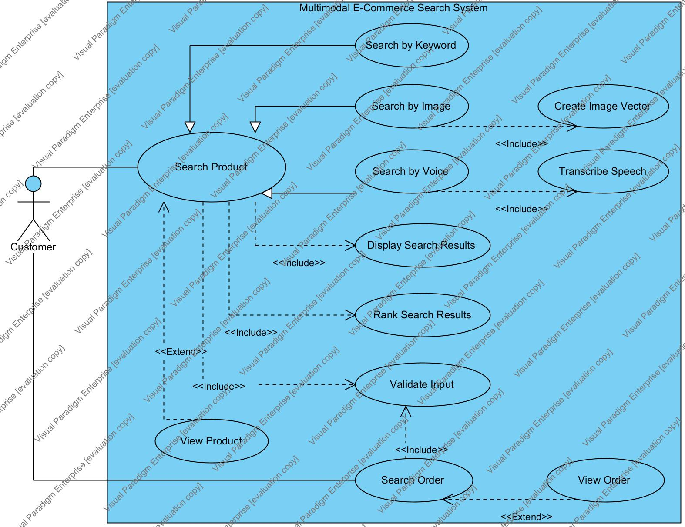
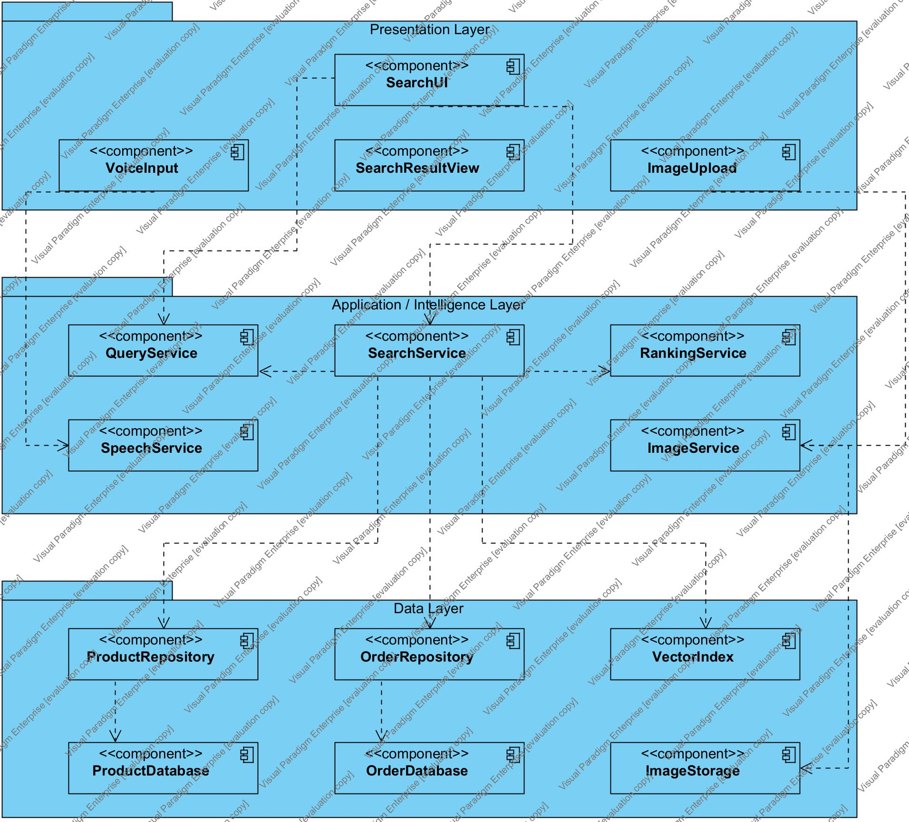
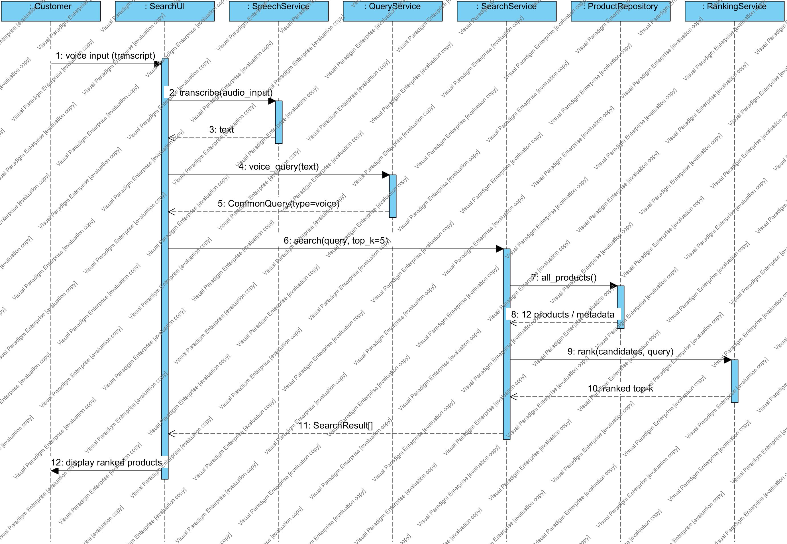
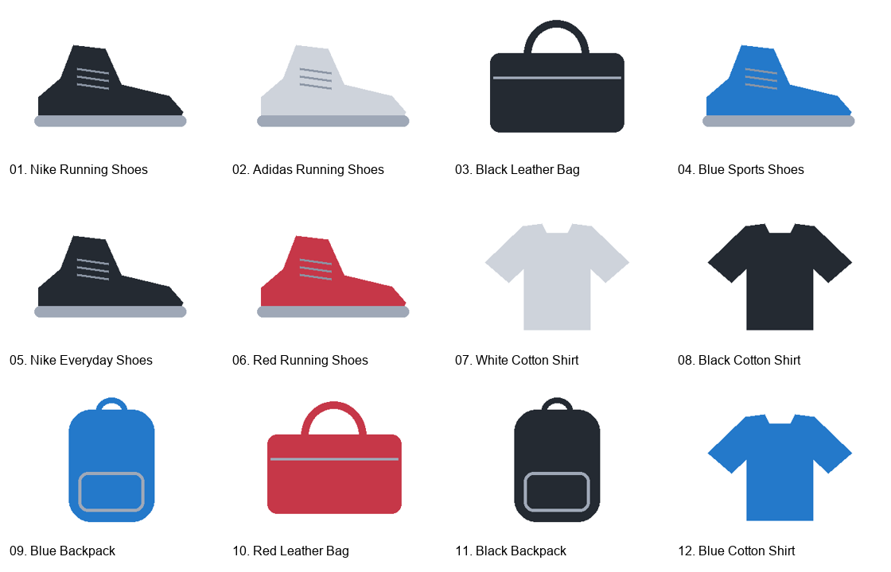
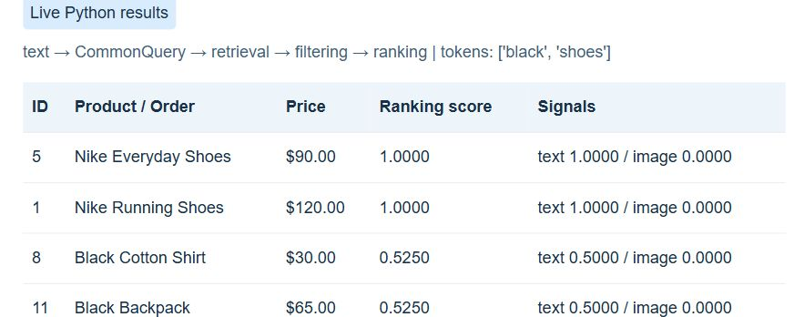
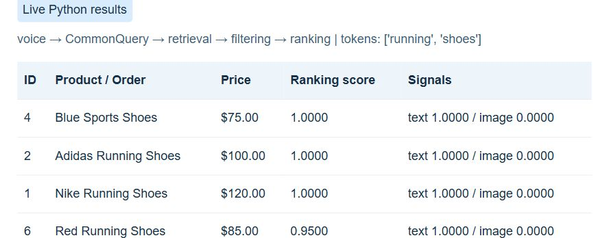
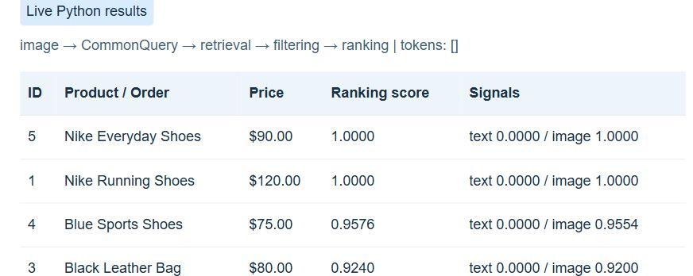

## SYSTEM DESIGN AND IMPLEMENTATION REPORT


**Assignment 06** - Design of a multimodal search system using a three-layer architecture, UML models, and an executable Python prototype.

| Item | Details |
| --- | --- |
| Student | Trần Hải Nam |
| Student ID | B23DCDT176 |
| Class | D23CQCE01-B |
| Completion date | 1 October 2026 |
| Modeling tool | Visual Paradigm 18.1 - Open Java API |


### Abstract


The prototype uses a common query representation for text, simulated voice transcripts, and images. The dataset contains 12 products, 3 orders, 12 product images, and 1 query image. Retrieval and ranking are separate operations. The system supports text-image fusion, price and category filters, and order queries scoped to a customer. The fixed evaluation set achieves 10 successful cases out of 12; all 13 functional tests pass.


### Report outline


| Pages | Contents |
| --- | --- |
| 2-3 | Introduction, problem description, and requirements analysis |
| 4-6 | Use Case, three-layer architecture, and Sequence Diagram |
| 7-8 | Python implementation and multimodal search methods |
| 9-10 | Execution examples for the search modes |
| 11-12 | Evaluation, discussion, conclusion, and references |


## 1. Introduction and Problem Description


Online shoppers may know a product name, describe their needs by speaking, or only have an image of the desired item. A multimodal search system must convert these inputs into consistent query data, retrieve candidate products, and rank the results by relevance.

The assignment aims to demonstrate the connection between requirements, UML models, and source code. The prototype prioritizes a clear structure, executable behavior, and verifiable results. It does not implement a complete e-commerce platform.


### 1.1. Scope and actor


**Customer** is the primary actor: searching for products through three input modes, viewing product details, finding orders, and checking order status. The system assumes that a customer ID is supplied externally. This version has no login screen or actual authentication mechanism.

| Input | Main processing | Output |
| --- | --- | --- |
| Text | Normalize, tokenize, and match metadata | Top-k products, scores, and prices |
| Voice | Transcript → QueryService → keyword search | Top-k products; explicitly simulated |
| Image | PNG/JPEG → 64-dimensional features → cosine | Top-k products with similar color and shape |
| Text + Image | Combine normalized scores | Top-k products with a fused score |
| Order query | Order ID or latest; scoped by customer_id | Order ID, status, date, and total |


### 1.2. Rules and assumptions


- Dataset prices are in USD. "Under 100" means price &lt; 100 and is a hard filter.
- Out-of-stock products may appear, but receive no stock bonus.
- Equal scores are resolved by ascending price, then ascending product ID.
- Sample images are original illustrations, not photographs of real products. Brand names are used only as educational metadata.


### 1.3. Interpretation of the assignment


The title and submission requirements specify Assignment 06, although some sample passages still refer to Assignment 05. The report and submission folder use Assignment 06. Task 6 requests text, voice, and image queries, so the implementation demonstrates all three and adds a combined query.


## 2. System Requirements Analysis


| ID | Functional requirement | Acceptance criterion |
| --- | --- | --- |
| FR01 | Search products by keyword | "black shoes" returns black shoes near the top |
| FR02 | Search using simulated voice | Transcript creates type=voice; uses the text search logic |
| FR03 | Search using an image | Read the image file and rank by cosine similarity |
| FR04 | Use a common query representation | Each query has type, tokens, embedding, filters, weights |
| FR05 | Separate retrieval from ranking | retrieve() creates candidates; rank() scores and selects Top-k |
| FR06 | View product information | view_product(id) returns metadata or None |
| FR07 | Filter by price and category | No result violates a hard filter |
| FR08 | Combine text and image | Use nonnegative weights that sum to 1 |
| FR09 | Find and view orders | Look up an order ID or latest order by customer_id |
| FR10 | Handle invalid inputs | Report empty queries, invalid images, and invalid top_k |


### 2.1. Nonfunctional requirements


| ID | Requirement | Verification |
| --- | --- | --- |
| NFR01 | Maintainability | Three separate layers; UI does not read product JSON |
| NFR02 | Reproducibility | Bundled data; no external AI service calls |
| NFR03 | Fast response on the sample dataset | Target: under 1 second per query over 12 products |
| NFR04 | Deterministic results | Fixed scoring and tie-breaking rules |
| NFR05 | Customer-scoped order access | C001 cannot retrieve C002's order O002 |
| NFR06 | Simple deployment | Python 3.10+, Pillow, README, and demo commands |

NFR05 checks access scope at the application layer; it does not replace authentication. The CLI accepts a customer ID as an argument, so this prototype is not a complete security system.


## 3. Use Case Model


Figure 1. Use case diagram for the e-commerce search system.



Keyword, image, and voice search specialize Search Product. Product search includes input validation, ranking, and result display; image search includes vector creation, and voice search includes transcription. View Product extends Search Product, while View Order extends Search Order. Order search also validates input. The diagram contains 12 use cases.

| Use case | Main flow and exceptions |
| --- | --- |
| Search Product | Enter input → create CommonQuery → retrieve → filter → rank → return results. Invalid input: report an error. No candidates: return an empty list. |
| Search by Voice | Enter transcript → SpeechService.transcribe() → voice_query() → search(). Clearly state that no audio recording occurs. |
| View Product | Customer selects a product ID; the application returns metadata. Missing product: None. |
| Search / View Order | Find an order ID or the latest order within the customer scope. Missing order or another customer's order: return no order. |

Preconditions: sample data is loaded; order queries require customer_id. Postconditions: product results contain IDs, names, prices, and scores. Searching does not modify the data.


## 4. Three-Layer Software Architecture


Figure 2. Component Diagram: dependencies run from Presentation to Application, and from Application to Data.



| Layer | Role in the source code |
| --- | --- |
| Presentation | SearchUI coordinates input; VoiceInput and ImageUpload call application services; SearchResultView displays results. WebHandler provides the local web interface. |
| Application / Intelligence | QueryService normalizes inputs; SpeechService simulates transcription; ImageService extracts features; SearchService retrieves and filters; RankingService calculates scores. |
| Data | ProductRepository and OrderRepository read JSON. VectorIndex stores vectors in RAM. ProductDatabase/OrderDatabase are JSON files; ImageStorage is the image directory. |

main.py assembles the dependencies: it initializes repositories and services, encodes images at startup, and injects these objects into the UI. The diagram shows the main dependencies rather than every internal call.


## 5. Sequence Diagram: Voice Search


Figure 3. Voice search sequence, with dashed return messages and activations indicating processing time.



Customer enters a transcript. SearchUI calls SpeechService, receives text, and calls QueryService.voice_query(). SearchService retrieves metadata from ProductRepository, creates candidates, and calls RankingService. The ranked list returns to the UI for display. VoiceInput is a presentation-layer wrapper omitted from this diagram to focus on the participants required by the assignment. Empty queries are rejected before searching. If there are no candidates, the UI displays "No matching products".


## 6. Python Implementation and Data


The package structure corresponds to the three layers. Neither SearchUI nor WebHandler reads JSON directly. SearchService receives a repository, VectorIndex, and RankingService through its constructor, allowing storage or search algorithms to change without modifying the display layer.

```python
assignment06/
  main.py, web.py, evaluate.py, requirements.txt
  presentation/ search_ui.py, web_ui.py
  application/ query_service.py, speech_service.py,
               image_service.py, search_service.py,
               ranking_service.py
  data/ product_repository.py, order_repository.py,
        vector_index.py, dataset/products.json,
        dataset/orders.json, dataset/images/
  tests/  demo/  uml/  report/
```


### 6.1. Catalog of 12 products


| ID | Product name | Category / color | USD | Stock |
| --- | --- | --- | --- | --- |
| 1 | Nike Running Shoes | shoes / black | 120 | 10 |
| 2 | Adidas Running Shoes | shoes / white | 100 | 15 |
| 3 | Black Leather Bag | bag / black | 80 | 20 |
| 4 | Blue Sports Shoes | shoes / blue | 75 | 12 |
| 5 | Nike Everyday Shoes | shoes / black | 90 | 8 |
| 6 | Red Running Shoes | shoes / red | 85 | 0 |
| 7 | White Cotton Shirt | shirt / white | 25 | 30 |
| 8 | Black Cotton Shirt | shirt / black | 30 | 18 |
| 9 | Blue Backpack | backpack / blue | 60 | 9 |
| 10 | Red Leather Bag | bag / red | 95 | 6 |
| 11 | Black Backpack | backpack / black | 65 | 11 |
| 12 | Blue Cotton Shirt | shirt / blue | 28 | 24 |


### 6.2. Data contracts


Product contains id, name, category, color, price, stock, brand, description, and image. The 64-dimensional embedding is calculated from the image at startup and stored in VectorIndex instead of duplicated in JSON. Order contains order_id, customer_id, date, status, total, and items; each item has product_id, quantity, and price. The 3 sample orders have totals consistent with their line items.

ProductRepository returns copies of metadata to prevent modification of internal data. OrderRepository looks up an order ID or selects the order with the latest date after filtering by customer_id.


## 7. Multimodal Search Methods


### 7.1. CommonQuery and keyword score


QueryService normalizes case, Vietnamese diacritics, and separators, and removes request words such as "find", "show", and "tim". A small mapping supports "giay den" → "shoes black". The parser extracts price limits from under/below/duoi. Matching uses exact tokens, not substrings.

```python
{
  "type": "voice", "query": "find running shoes",
  "tokens": ["running", "shoes"], "embedding": null,
  "filters": {"max_price": null, "category": null},
  "weights": {"text": 1, "image": 0}
}
```

**S_text(p,q)** = number of query tokens found in product metadata / number of query tokens. Text retrieval keeps products with S_text &gt; 0. Hard price and category filters are applied before ranking.


### 7.2. Image features, cosine similarity, and fusion


ImageService corrects EXIF orientation, converts to RGB, fits the image into a 64×64 white canvas, and divides it into a 4×4 grid. Each cell has three mean values (1 - R/255, 1 - G/255, 1 - B/255) and the proportion of pixels with min(R,G,B) &lt; 235. This gives 16×4 = 64 dimensions. These are actual pixel-based image features, not deep learning embeddings.

**S_image** = dot(z_q,z_p) / (norm(z_q) × norm(z_p)). Vectors with unequal dimensions or nonfinite values are rejected. A zero-norm vector receives cosine 0. A white image with no foreground raises an error.

**Relevance** = w_text × S_text + w_image × S_image.
**Final score** = 0.95 × Relevance + 0.05 × in_stock.
Text/voice uses (1,0), image uses (0,1), and fusion uses (0.5,0.5). The two signals do not share a vector space. The system combines scores rather than directly adding keyword and image vectors.

Figure 4. The 12 bundled illustrations; images with the same product type and color can be identical.




## 8. Text and Voice Search Examples


The screenshots come from the local web interface calling the actual Python implementation. The CLI records the complete input, processing steps, and scores in demo/console_output.txt. Detailed results are stored in demo/demo_results.json.

Figure 5. Text query "black shoes": normalization produces two tokens, followed by retrieval and ranking.



| Top | Product | S_text | Final |
| --- | --- | --- | --- |
| 1 | Nike Everyday Shoes | 1.0000 | 1.0000 |
| 2 | Nike Running Shoes | 1.0000 | 1.0000 |
| 3 | Black Cotton Shirt | 0.5000 | 0.5250 |

Figure 6. Voice query "find running shoes": SpeechService accepts a transcript; normalization removes "find".



| Top | Product | S_text | Final |
| --- | --- | --- | --- |
| 1 | Blue Sports Shoes | 1.0000 | 1.0000 |
| 2 | Adidas Running Shoes | 1.0000 | 1.0000 |
| 3 | Nike Running Shoes | 1.0000 | 1.0000 |

Text: both black shoes score 1.0000, with the USD 90 product ranked ahead of the USD 120 product. Voice: Blue Sports Shoes includes "running" in its description, so it scores 1.0000 and has a lower price than the tied candidates. No microphone processing or speech recognition model is used.


## 9. Image, Fusion, and Order Examples


Figure 7. Image search uses query_black_shoe.png, a resized version of product 05's image.



| Mode / Top | Product | S_image | Final |
| --- | --- | --- | --- |
| Image / 1 | Nike Everyday Shoes | 1.0000 | 1.0000 |
| Image / 2 | Nike Running Shoes | 1.0000 | 1.0000 |
| Image / 3 | Blue Sports Shoes | 0.9554 | 0.9576 |
| Fusion / 1 | Nike Everyday Shoes | 1.0000 | 1.0000 |
| Fusion / 2 | Nike Running Shoes | 1.0000 | 1.0000 |
| Fusion / 3 | Blue Sports Shoes | 0.9554 | 0.7413 |

The image passes through ImageService → 64 values → VectorIndex → RankingService. Nike Everyday Shoes and Nike Running Shoes use identical black shoe illustrations, so both have cosine similarity close to 1; price determines their order. This verifies the pipeline on sample illustrations, rather than demonstrating brand recognition from images.

Fusion receives "black shoes" together with the shoe image. Both image and keyword scores are close to 1 for the two black shoes. Blue Sports Shoes falls to 0.7413 because it matches only one of the two tokens, despite having a similar image shape.


### 9.1. Order queries


```python
python main.py --mode order --query "find my order 20261001"
# C001 -> 20261001 | Processing | total: 90 USD
python main.py --mode order --query "where is my latest order"
# C001 -> 20261001 (date: 2026-10-01T08:00:00)
```

If C001 requests O002, the system returns None because that order belongs to C002. The web interface fixes the customer ID at C001; the CLI accepts --customer to demonstrate other customers.


## 10. Experimental Evaluation


The evaluation contains 12 queries with expected labels declared beforehand in evaluate.py. A query succeeds when its Top-1 result belongs to the accepted ID set. For queries with no matching products, a correctly empty list also counts as success. The set contains straightforward cases and two challenging cases; it is not an independent image or language benchmark.

| ID / Mode | Input | Actual Top-1 | Pass |
| --- | --- | --- | --- |
| T01 / text | black shoes | 5 | Yes |
| T02 / voice | find running shoes | 4 | Yes |
| T03 / image | query_black_shoe.png | 5 | Yes |
| T04 / text | find Nike shoes under 100 dollars | 5 | Yes |
| T05 / text | white shirt | 7 | Yes |
| T06 / text | blue backpack | 9 | Yes |
| T07 / multimodal | black shoes | 5 | Yes |
| T08 / order | find order O001 | O001 | Yes |
| T09 / order | where is my latest order | 20261001 | Yes |
| T10 / text | spaceship | Empty | Yes |
| T11 / text | sneekers | Empty | No |
| T12 / text | not black shoes | 5 | No |

**Success Rate** = 10 / 12 = **83.33%**. This measures performance on a small synthetic dataset and should not be generalized to real product data or new user queries.


### 10.1. Analysis of the two failures


**T11 - "sneekers":** the system has no spelling correction or synonym mapping for sneakers. It therefore returns no products, although the user intends to find sports shoes.
**T12 - "not black shoes":** "not" is treated as an ordinary token, so the system still prioritizes black shoes. There is no negation parser, making the result inconsistent with the intended request.


### 10.2. Tests and processing time


All 13 automated tests pass, covering text/voice equivalence, price and category filters, cosine similarity, invalid images, top-k, weights, stock, and customer-scoped orders. On the machine used for this assignment, 100 "black shoes" queries average 0.136 ms, with P95 0.153 ms. These measurements cover queries after initialization, excluding initial image encoding, the web interface, and transcript/image input loading.


## 11. Discussion and Conclusion


### 11.1. Results and limitations


The prototype supports all three required input modes and maintains the Presentation → Application → Data flow. Retrieval and ranking are distinct functions; all input modes use a common query object. Extensions include score-level fusion, price/category filters, a stock signal, order lookup, and a local web interface.

Main limitations: voice is simulated; image features are sensitive to background, color, and position; illustrations with the same color and shape cannot distinguish brands; keyword matching does not understand negation or spelling mistakes; data and VectorIndex operate at a small scale. There is no authentication, data administration, transaction processing, or persistent update workflow. The .vpp file contains three editable UML diagrams.


### 11.2. Future work


SpeechService could be replaced with speech recognition, ImageService with a deep learning encoder, and VectorIndex with an approximate search index. Intent understanding, negation handling, and spelling correction could be added. Before real deployment, evaluation should use independent real images, graded relevance labels, Precision@k/Recall@k, and actual customers.


### 11.3. Conclusion


The main lesson is to organize the system around its intelligent components. Different inputs are normalized into a retrieval, filtering, and ranking pipeline with clear responsibilities. Actual execution demonstrates that the design translates into working code. The failure cases identify areas for improvement and make the prototype's limitations explicit.


### 11.4. References and submission files


[1] Assignment 06: Multimodal Search System for E-Commerce, supplied assignment document inf_sys_analysis_design_assignment_06_design_code.pdf.
[2] Visual Paradigm - Plug-in API: <link href="https://www.visual-paradigm.com/support/documents/pluginapi.jsp" color="black">visual-paradigm.com/support/documents/pluginapi.jsp</link>.
[3] Visual Paradigm - Running plug-in silently: <link href="https://circle.visual-paradigm.com/docs/open-api/running-plug-in/running-visual-paradigm-plug-in-silently/" color="black">Guide to running the Open API without the user interface</link>.

The submission includes this PDF, an editable Word report, uml/assignment06_multimodal_search_final.vpp, three-layer Python source code, products.json, orders.json, sample images, README, JSON/TXT demo outputs, CSV/JSON evaluation results, tests, and evidence that the UML project was reopened. README documents the environment, execution commands, and limitations.